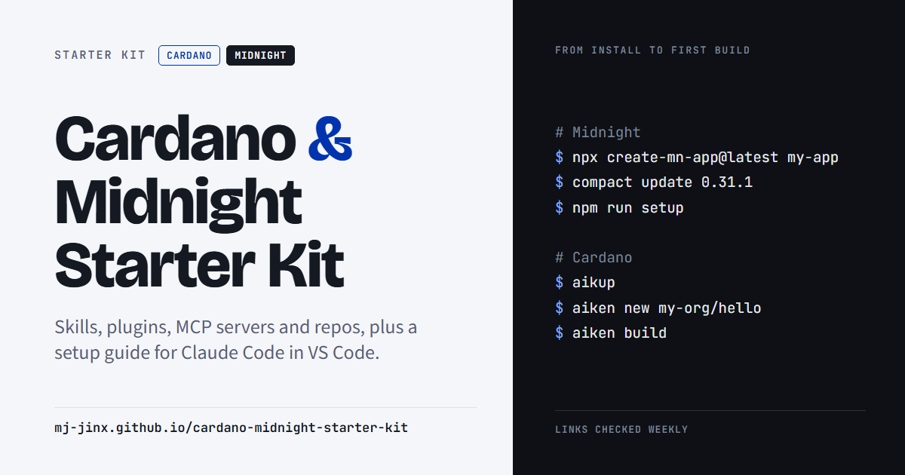

[](https://mj-jinx.github.io/cardano-midnight-starter-kit/)

# Cardano & Midnight Starter Kit

A setup guide for Claude Code in VS Code, plus a searchable catalog of 360+ repos, tools and Midnight Improvement Proposals for building on Cardano and Midnight.

**Read it here: https://mj-jinx.github.io/cardano-midnight-starter-kit/**

> [!WARNING]
> **Disclaimer.** This is a starter kit for learning, not an endorsement or an audit. Check every repo, tool and command yourself before you use it. This space changes fast: projects get updated, abandoned or compromised without notice, and entries here can go out of date. You use anything listed here at your own risk, and the author accepts no responsibility for any loss, damage or other outcome. Nothing here is financial, legal or security advice.

## What's inside

- **Setup guide:** Windows (WSL), macOS and Linux. It covers VS Code extensions, Node, the Compact toolchain, the proof server, Aiken, Claude Code plugins and skills, MCP servers, wallets, faucets and first builds, plus watch-outs.
- **Midnight tab:** official repos, community tools and DApps, every MIP, and the projects listed in Midnight Awesome DApps.
- **Cardano tab:** languages, SDKs, chain APIs, infrastructure, DEXs, lending, oracles and research.
- **AI tools tab:** Claude Code plugins, agent skills and MCP servers for both chains.
- **Labels:** every entry is marked **Official** (published by the chain's own organizations: Midnight, Cardano Foundation, Intersect, IOG) or **Community** (everyone else, listed but not audited), plus a category and a complexity level (Beginner, Intermediate or Advanced).
- **Search and filters:** search across everything, then filter by source, level and category. A search can be shared as a link, for example `?q=oracle`.

## Updating

The page is `index.html`. The catalog is `data/catalog.json`, and each entry looks like this:

```json
{
  "name": "midnight-js",
  "owner": "midnightntwrk",
  "url": "https://github.com/midnightntwrk/midnight-js",
  "repo": "midnightntwrk/midnight-js",
  "tab": "midnight",
  "chain": "midnight",
  "category": "SDKs & libraries",
  "level": "Intermediate",
  "desc": "TypeScript SDK for deploying and calling contracts.",
  "official": true,
  "start": true,
  "note": null
}
```

- **`tab`** is `midnight`, `cardano` or `ai`, and `category` must be one of that tab's categories listed at the top of the file.
- **`also` and `alsoCategory`** show an entry on a second tab.
- **`start: true`** puts the entry in the tab's "Start here" cards.
- **`note`** shows a warning line under the entry.

Edit the file on GitHub with the pencil icon or locally, then commit to `main`. GitHub Pages republishes in a minute or two.

## Automatic upkeep

- **Refresh catalog** (`.github/workflows/refresh-catalog.yml`, Sundays): updates stars, last-updated dates and archived status from GitHub. A repo that is deleted or made private is marked `unavailable` and hidden from the site.
- **Link check** (`.github/workflows/link-check.yml`, Mondays and on every push): checks every link and opens an issue listing any that break.

You can run either one by hand from the **Actions** tab.

## Banner

The banner (`og-image.png`) is the preview image shown when the link is shared. Its source is `assets/banner-source.html`. To change it, edit that file and take a 1200×630 screenshot, for example with headless Edge or Chrome:

```bash
msedge --headless=new --hide-scrollbars --window-size=1200,630 --virtual-time-budget=8000 --screenshot=og-image.png file:///full/path/to/assets/banner-source.html
```

Social sites cache previews, so a changed banner can take a while to show up where the link was already shared.

## Suggest a fix

If a link is broken, a version is out of date or a project is missing, please open an issue or a pull request.
