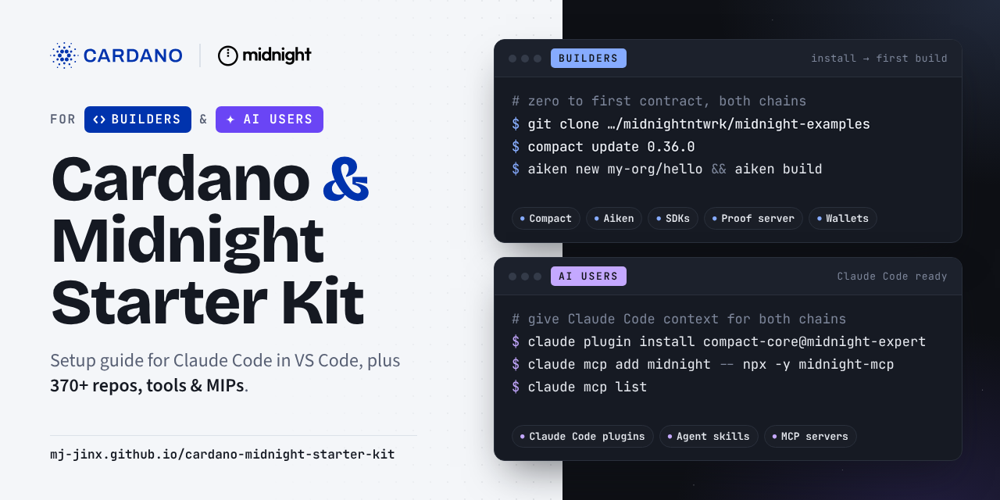

[](https://mj-jinx.github.io/cardano-midnight-starter-kit/)

# Cardano & Midnight Starter Kit

A setup guide for Claude Code in VS Code, plus a searchable catalog of 370+ repos, tools and Midnight Improvement Proposals for building on Cardano and Midnight.

**Read it here: https://mj-jinx.github.io/cardano-midnight-starter-kit/**

> [!WARNING]
> **Disclaimer.** This is a starter kit for learning, not an endorsement or an audit. Check every repo, tool and command yourself before you use it. This space changes fast: projects get updated, abandoned or compromised without notice, and entries here can go out of date. You use anything listed here at your own risk, and the author accepts no responsibility for any loss, damage or other outcome. Nothing here is financial, legal or security advice.

## What's inside

- **Setup guide:** Windows (WSL), macOS and Linux. It covers VS Code extensions, Node, the Compact toolchain, the proof server, Aiken, Claude Code plugins and skills, MCP servers, wallets, faucets and first builds, plus watch-outs.
- **All tools tab (the page opens here):** every catalog entry in one list, grouped by section (Midnight, Cardano, AI tools) with a section filter.
- **Midnight tab:** official repos, community tools and DApps, every MIP, and the projects listed in Midnight Awesome DApps.
- **Cardano tab:** languages, SDKs, chain APIs, infrastructure, DEXs, lending, oracles and research.
- **AI tools tab:** Claude Code plugins, agent skills and MCP servers for both chains.
- **Labels:** every entry is marked **Official** (published by the chain's own organizations: Midnight, Cardano Foundation, Intersect, IOG) or **Community** (everyone else, listed but not audited), plus a category and a complexity level (Beginner, Intermediate or Advanced).
- **Search and filters:** search across everything, then filter by source, level and category. A search can be shared as a link, for example `?q=oracle`.
- **Sorting:** **Recommended** (the default) or **Latest updated**, which lists entries by their last GitHub push, newest first. Entries without a GitHub repo come last. Share it as a link with `?sort=updated`, for example `?sort=updated#all`.

## Updating

The page is `index.html`. The catalog is `data/catalog.json`, and each entry looks like this:

```json
{
  "name": "midnight-js",
  "owner": "midnightntwrk",
  "url": "https://github.com/midnightntwrk/midnight-js",
  "repo": "midnightntwrk/midnight-js",
  "tab": "midnight",
  "chain": "midnight",
  "category": "SDKs & libraries",
  "level": "Intermediate",
  "desc": "TypeScript SDK for deploying and calling contracts.",
  "official": true,
  "start": 4,
  "note": null,
  "tags": [],
  "links": [{ "label": "Docs", "url": "https://docs.midnight.network" }]
}
```

- **`tab`** is `midnight`, `cardano` or `ai`, and `category` must be one of that tab's categories listed at the top of the file.
- **`also` and `alsoCategory`** show an entry on a second tab.
- **`start`** is a rank: a number from 1 puts the entry in the tab's "Start here" cards in that order, and `0` leaves it out.
- **`note`** shows a warning line under the entry. **`tags`** add extra chips, and **`links`** add extra links next to the entry.
- **`stars`, `updated`, `pushed`, `archived` and `unavailable`** are filled in by the weekly refresh, so you don't need to set them by hand.

Edit the file on GitHub with the pencil icon or locally, then commit to `main`. GitHub Pages republishes in a minute or two.

## Automatic upkeep

- **Refresh catalog** (`.github/workflows/refresh-catalog.yml`, Sundays): updates stars, last-push dates (used by the Latest updated sort) and archived status from GitHub. A repo that is deleted or made private is marked `unavailable` and hidden from the site.
- **Link check** (`.github/workflows/link-check.yml`, Mondays and on every push): checks every link and opens an issue listing any that break.

You can run either one by hand from the **Actions** tab.

## Banner

The README banner is `assets/readme-banner.png` (1280×640). It is a separate image, so update its commands when the guide's commands change.

The banner at the top of the site is HTML and CSS in `index.html`, so it adapts to phones and dark mode. Its logos are alpha masks in `assets/logos/`, coloured by CSS.

The preview image shown when the link is shared (Discord, X, Slack and others) is `og-image.png`, a copy of the README banner. To change it:

1. Replace `og-image.png` (1280×640) and keep `assets/readme-banner.png` in sync.
2. In `index.html`, bump the `?v=` value on the `og:image` and `twitter:image` URLs, for example `og-image.png?v=20261111`. Social sites cache previews by URL, and the new value makes them fetch the new image.
3. To refresh a preview that was already posted, share the link with any query added, for example `https://mj-jinx.github.io/cardano-midnight-starter-kit/?v=2`. Discord caches each page URL's embed, so a new URL gets a fresh one.

`assets/banner-source.html` is the earlier generated preview design (1200×630), kept for reference.

## Suggest a fix

If a link is broken, a version is out of date or a project is missing, please open an issue or a pull request.
